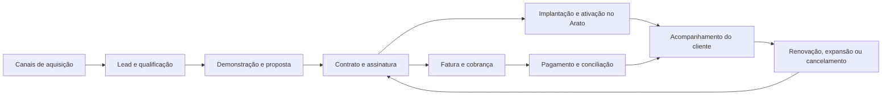

# Arato — aplicação própria de gestão comercial e financeira

Data: 17/11/2026 — America/Cuiaba.

Estado: proposta de escopo e arquitetura, baseada em leitura do código do Arato. Não representa uma aplicação implementada ou uma migração executada.

Decisões confirmadas pelo usuário: **aplicação separada, conectada ao Arato**; canais de aquisição **Instagram, site, WhatsApp e Google**; cobranças atuais no **Asaas vinculado ao MentoraSys**. O nome “Arato Gestão” abaixo é provisório. A localização do projeto, o formato de uso de cada canal e o acesso ao histórico/exportação do MentoraSys ainda precisam ser definidos.

O detalhamento dos conectores e da transição financeira está em [INTEGRACOES.md](INTEGRACOES.md).

## 1. Objetivo e fronteiras

Controlar a operação do negócio SaaS: aquisição, relacionamento comercial, propostas, contratos, assinaturas, faturamento, recebimentos, despesas da operação, implantação, renovação, expansão e cancelamento.

O sistema operacional dos clientes continua no Arato. A nova aplicação terá interface, acesso administrativo, banco e publicação próprios. Ela não deve reutilizar o CP/CR das fazendas para controlar a receita ou as despesas da empresa fornecedora do software.

A ficha do cliente será o ponto central, com contatos, oportunidades, contratos, assinaturas, faturas, pagamentos, documentos, tarefas, utilização do produto e histórico de atendimento. Uma oportunidade ainda não ganha não precisa criar uma conta de produção no Arato.

## 2. Fluxo do negócio

Aceite comercial, assinatura do contrato, liberação do ambiente, geração de fatura e recebimento são eventos distintos. A política de ativação deve ser configurada por produto/contrato, sem presumir pagamento ao ganhar uma oportunidade.

## 3. Módulos propostos

| Módulo | Controles necessários | Primeira etapa |
|---|---|---|
| Painel executivo | Receita recorrente, recebimentos, atrasos, funil, renovações, tarefas e alertas | Sim, com números derivados das fontes conciliadas |
| Aquisição | Formulários, origem/campanha/UTM, referência do canal, indicação e parceiro; prevenção de duplicidade | Site e atribuição de origem primeiro; Instagram/WhatsApp/Google por seus conectores oficiais |
| CRM | Leads, empresas/pessoas, contatos, decisores, responsáveis, etapas, motivos de perda, atividades e agenda | Sim |
| Propostas e vendas | Itens, plano/módulos, implantação, desconto, validade, versões, negociação e aceite | Sim |
| Contratos | Documento e versões, vigência, condições, contatos, assinatura/aceite, aditivos e cancelamento | Sim; integração de assinatura conforme provedor |
| Clientes | Vínculo com `conta_id` existente, dados de cobrança, contatos separados, produtos contratados e histórico | Sim, reaproveitando os cadastros do Arato |
| Assinaturas | Mensal/anual, recorrência, descontos com prazo, isenções, trial, limites, mudança de plano e cancelamento programado | Sim; ajustes proporcionais segundo política definida |
| Faturamento e recebimentos | Faturas por período, itens, cobranças, baixa/estorno, pagamento parcial, juros/desconto, taxa e valor líquido | Sim |
| Financeiro da empresa | Contas a pagar/receber, categorias, bancos, conciliação, fluxo de caixa e demonstrativo gerencial | Recebíveis primeiro; despesas e resultado na etapa seguinte |
| Cobrança e comunicações | Envio automático de fatura, lembretes, atrasos, confirmação, histórico de entrega e falhas | Após validação em ambiente de testes |
| Renovação e reajuste | Avisos por antecedência, responsável, tarefa, renovação automática/manual, aceite e aditivo | Sim |
| Implantação e sucesso do cliente | Checklist, treinamento, responsável, marcos de ativação, uso e risco de cancelamento | Checklist inicial; sinais de uso na segunda etapa |
| Atendimento | Solicitações, responsável, prazo, histórico, base de conhecimento e vínculo com o cliente | Evolução; integrar ferramenta já existente se houver |
| Parceiros e comissões | Indicação, atribuição, regras, competência, estorno e apuração conforme recebimento | Depois da definição da política comercial |
| Integrações e administração | Usuários/perfis, auditoria, integrações, fila de eventos, tentativas, falhas e conciliação | Desde a primeira etapa |
| Documentos fiscais do SaaS | NFS-e da prestação do serviço e seu vínculo com cobrança/cliente | Integração específica após configuração fiscal da empresa |

Integração com um canal não significa disparar mensagens automaticamente. Captura de leads, registro de contatos e envio ativo devem ter configurações independentes, com responsáveis e histórico.

## 4. O que já existe no Arato

Leitura de código, sem consulta de dados privados de clientes, chamadas financeiras ou alteração de produção:

- `app/admin/clientes/page.tsx`: cadastro de contas/clientes com situação comercial, origem e etapa CRM simples.
- `app/admin/faturamento/page.tsx`: assinaturas e pagamentos; cálculo de MRR/ARR a partir de assinaturas.
- `app/admin/page.tsx`: situação dos clientes, mensalidades e outro cálculo de MRR a partir de contas.
- `lib/planos.ts`, `app/admin/planos/page.tsx` e tabelas `planos`/`planos_config`: catálogo e configurações de planos. A reconciliação deve identificar qual configuração está efetivamente em uso.
- `lib/asaas.ts`: cliente do Asaas com cobranças, assinaturas e consulta de pagamentos.
- `app/api/asaas/cobrar/route.ts`: criação de cobrança avulsa e registro local.
- `app/api/asaas/webhook/route.ts`: consulta do estado atual do pagamento e processamento de evento no banco; usar como referência, sem copiar suas limitações de modelagem.
- `app/api/cron/cobranca/route.ts` e `vercel.json`: rotina diária de trial, atrasos, novas cobranças e e-mail de vencimento.
- `app/api/saas/route.ts` e `app/api/cadastro/route.ts`: integração inicial de site/trial/cadastro.
- Seção 72 do SQL: tabelas de planos, assinaturas e pagamentos e campos CRM em `contas`.

Não foi encontrado o código do MentoraSys no diretório raiz local examinado nem referência a ele no código rastreado do Arato. A análise não confirma seu esquema, seus contratos, sua conta de cobrança ou seus formatos de exportação.

## 5. Pontos que exigem desenho próprio

1. **CRM básico:** hoje a etapa comercial fica junto da conta. O novo CRM precisa suportar vários contatos/oportunidades por cliente, histórico de etapas, tarefas, propostas e motivos de perda.
2. **Etapas com nomenclaturas distintas:** o conjunto de etapas de CRM exibido na página e o definido na migração não coincide integralmente. Mapear os valores reais na importação, preservando valores desconhecidos para conferência.
3. **Receita com mais de uma origem:** mensalidade em `contas` e preço/periodicidade em `assinaturas` alimentam painéis diferentes. A proposta é calcular recorrência pelo contrato/assinatura versionados e manter o histórico do valor de cada fatura.
4. **Trial não é dívida automaticamente:** o cron atual pode marcar trial expirado como inadimplente e gerar cobrança. No novo desenho, trial encerrado sem contratação é uma situação comercial própria; faturamento exige a regra/aceite correspondente.
5. **Recorrência e calendário:** o cron busca vencimentos exatamente em D-3. Não foi identificada, nas rotas de cobrança e webhook lidas, uma atualização consistente do próximo ciclo. O novo sistema precisa recuperar execuções perdidas e definir quem gera as cobranças futuras.
6. **Falhas entre provedor e banco:** há fluxos que criam a cobrança externa antes de confirmar a inserção local. Uma falha intermediária precisa ser conciliada pelo identificador da operação, sem criar outra cobrança.
7. **Comunicação confirmada:** o e-mail atual não possui, nessa rotina, um registro próprio de entrega e repetição por fatura/tipo de aviso. A nova fila deve guardar envio solicitado, aceito, entregue ou falho, sem contar um simples HTTP concluído como entrega ao destinatário.
8. **Cancelamento coordenado:** a página de faturamento altera o status local da assinatura; o novo fluxo deve tratar também recorrência do provedor, cobranças já geradas, saldo e acesso ao produto conforme a política contratual.
9. **Documento fiscal, fatura e pagamento distintos:** uma fatura pode estar aberta, seu documento fiscal já emitido e o pagamento ainda não recebido. Esses estados não podem ocupar um único campo.

Esses pontos são achados de código para orientar o projeto. Não comprovam, por si só, divergências em todos os registros de produção.

## 6. Fontes de referência e responsabilidade pelos dados

| Informação | Fonte principal proposta | Como conectar |
|---|---|---|
| ID da conta, ambiente, usuários, permissões do produto e uso | Arato | API administrativa restrita e eventos versionados |
| Lead, contato comercial, oportunidade, proposta e atividade | Nova aplicação | Cadastro próprio; vínculo com a conta quando ela existir |
| Contrato, preço negociado, ciclo, renovação e condições | Nova aplicação | Versões e histórico; alterações aprovadas propagadas ao produto |
| Cobrança externa, transação, confirmação e taxa do gateway | Provedor financeiro | API e webhooks; espelho e conciliação na nova aplicação |
| Fatura comercial, itens, competência e saldo | Nova aplicação | Relacionamento com uma ou mais cobranças/pagamentos |
| Acesso/licença do cliente | Arato | Comando explícito e auditável, separado da situação financeira |
| Histórico anterior | MentoraSys e Gestão Arato atuais | Importação com IDs de origem e conferência; sem recriar pagamentos |

O mesmo cliente pode ter grupo econômico, pagador, contato financeiro e usuários do produto diferentes. A integração deve usar IDs estáveis; nome, e-mail ou CPF/CNPJ isoladamente não substituem o identificador da conta.

## 7. Estrutura técnica sugerida

- Repositório e aplicação próprios, com autenticação administrativa e publicação independentes.
- Aproveitar o conhecimento atual de Next.js/React e PostgreSQL/Supabase, sem compartilhar credenciais amplas de produção com o navegador ou duplicar a base operacional das fazendas.
- Banco próprio para CRM, contratos e gestão financeira. Uma representação local dos clientes Arato guarda somente os dados administrativos necessários, com referência ao `conta_id` original.
- API entre aplicações com permissões específicas para consultar cadastro, provisionar contrato/licença e consultar sinais de uso. Controles técnicos de suporte continuam separados da permissão de negociar preço ou registrar recebimento.
- Processamento de tarefas em fila: geração/envio de faturas, lembretes, renovação e sincronização. Falhas ficam visíveis e podem ser retomadas.
- Eventos e comandos com identificadores de repetição; transações locais e histórico de antes/depois. Uma mesma cobrança/evento não pode ser aplicado duas vezes.
- Segredos e integrações apenas no servidor; acesso por função (gestor, comercial, financeiro, implantação/suporte e leitura).

Modelo inicial: organizações/grupos, contatos, leads, oportunidades, atividades, propostas/itens/versões, contratos/aditivos, clientes-vínculos-Arato, assinaturas/ciclos, faturas/itens, cobranças externas, pagamentos/compensações, despesas, contas bancárias, movimentos/conciliações, documentos fiscais, notificações, tarefas, eventos de integração e auditoria.

Manter situação comercial, vigência contratual, situação da assinatura, saldo financeiro e acesso ao Arato em campos distintos, com regras explícitas de transição.

## 8. Automações propostas

Regras exemplificativas e configuráveis, não instruções de envio já ativadas:

- Lead recebido → registrar canal/campanha, evitar duplicidade e criar tarefa para o responsável.
- Oportunidade ganha → consolidar versão aceita, preparar contrato e checklist de implantação.
- Contrato ativado → criar assinatura e calendário; preparar a licença segundo a política do cliente.
- Fatura gerada → solicitar cobrança e enfileirar envio com link e dados do período.
- Aproximação do vencimento → lembrete configurado, por exemplo D-7/D-3/D0.
- Cobrança vencida → sequência de acompanhamento, por exemplo D+3/D+7, com regras de pausa e exceções.
- Pagamento confirmado → conciliar fatura, registrar valor bruto/taxas/líquido, confirmar pagamento e atualizar situação financeira.
- Renovação próxima → avisos e tarefas, por exemplo D-60/D-30/D-15/D-7, observando a antecedência do contrato.
- Reajuste → simular e aprovar a alteração, preservar versão anterior e aplicar a partir do ciclo correto.
- Baixa utilização/implantação parada → tarefa de acompanhamento, sem bloquear automaticamente o cliente.
- Cancelamento → motivo, data efetiva, recorrência futura, obrigações já existentes, acesso e retenção do histórico tratados separadamente.

NFS-e automática depende do emitente correto, município/serviço e configuração fiscal habilitados. Deve ter sua própria confirmação e fila de pendências.

## 9. Indicadores para controlar o SaaS

- Funil e conversão por etapa/canal; tempo até primeiro contato e até a venda; propostas em aberto e motivos de perda.
- Receita mensal recorrente (MRR) e anual recorrente normalizada (ARR), separadas do valor total vendido, faturado e recebido.
- Entrada, expansão, redução e cancelamento de receita recorrente; retenção de clientes e receita.
- Caixa recebido bruto/líquido, faturas abertas, atraso por faixa, taxas e estornos.
- Renovações previstas, contratos sem próxima ação e reajustes pendentes.
- Implantação, tempo até ativação e clientes com risco de saída.
- Despesas, margem e fluxo de caixa da operação do Arato.
- Custo de aquisição e retorno por canal quando houver despesas e atribuição confiáveis. LTV e prazo de retorno só devem ser apresentados com base e metodologia explícitas.

Cada indicador deve permitir abrir os registros que compõem seu total. Implantação avulsa, receita não recorrente, trial e faturamento anual antecipado precisam de tratamento próprio, evitando inflar recorrência ou confundir caixa com receita.

## 10. Sequência de implantação

### Etapa 1 — Base, cadastros e CRM

Aplicação administrativa isolada, perfis, auditoria, ligação somente de leitura aos clientes do Arato, cadastro de leads/contatos, oportunidades, agenda e uma integração inicial de aquisição. Ficha única e mapeamento dos dados legados.

Critério de aceite: um lead percorre o funil sem criar contas/cobranças indevidas; um cliente já existente abre na ficha correta; permissões comerciais não concedem acesso geral aos dados operacionais das fazendas.

### Etapa 2 — Comercial e assinatura

Propostas versionadas, condições negociadas, contrato/anexos/aceite, implantação, calendário de assinatura e renovação. Preparar ordens de faturamento em modo de simulação.

Critério de aceite: proposta aceita, versão contratual e preço vigente são rastreáveis; alteração de plano/valor não modifica faturas históricas.

### Etapa 3 — Faturamento e cobrança

Faturas, Asaas atual ligado ao MentoraSys, importação das cobranças existentes, confirmação de pagamentos, envios, inadimplência e conciliação. Testes de falha/repetição antes da transferência do emissor de cobrança.

Critério de aceite: cobrança repetida não duplica fatura nem gateway; evento atrasado não apaga recebimento confirmado; falha de envio aparece como pendência; migração não cobra novamente um período quitado.

### Etapa 4 — Financeiro completo e gestão de clientes

Despesas, bancos, caixa, resultado gerencial, fiscal do SaaS, indicadores de utilização, acompanhamento, parceiros e comissões. Integrar os demais canais confirmados e os relatórios de retenção/expansão.

Critério de aceite: recebimentos e despesas reconciliáveis, taxas/estornos explícitos e indicadores demonstráveis a partir de seus registros.

## 11. Migração sem duplicar cobranças

1. Inventariar clientes, contratos, assinaturas, faturas e recebimentos do MentoraSys e do Arato; identificar também a conta e IDs do provedor financeiro.
2. Importar dados para conferência com IDs originais e origem; vincular ao `conta_id` do Arato. Casos ambíguos ficam pendentes de revisão, sem fusão automática.
3. Comparar clientes ativos, valores/ciclos, saldos em aberto, pagamentos e próximas cobranças. Histórico pago é importado como histórico, sem gerar cobrança.
4. Acompanhar eventos em modo de conferência, com envios e emissão financeira desativados.
5. Definir um único responsável por gerar a cobrança de cada assinatura: sistema antigo, provedor recorrente ou nova aplicação. Desativar a geração antiga para os clientes transferidos antes da ativação nova.
6. Transferir um grupo piloto, com plano de retorno e conferência da primeira competência.
7. Ampliar apenas quando quantidades, saldos e próxima competência estiverem conciliados.

A nova aplicação não deve começar a faturar apenas porque uma conta existente aparece como ativa. A mudança de dono da cobrança é uma operação própria.

## 12. Pontos ainda a confirmar

- Formato dos canais confirmados: Instagram profissional/Direct/anúncios, WhatsApp Business/API e Google orgânico/Ads; responsáveis e permissões das contas.
- Conta Asaas atual, identificação das cobranças exclusivas do Arato e responsável pela geração de cada recorrência (MentoraSys ou Asaas).
- Acesso ao projeto/exportação do MentoraSys para mapear dados; nenhuma necessidade de compartilhar segredos no chat.
- Entidade que contrata/fatura o serviço, ciclos comerciais usados e política de implantação, trial, reajuste, renovação, inadimplência e cancelamento.
- Equipe inicial e separação de permissões.
- Ferramentas já usadas para assinatura de contrato, e-mail, WhatsApp e atendimento.

Essas definições fecham conectores e regras comerciais; não impedem a organização do domínio, dos cadastros e da proposta técnica.

## Fontes consultadas

- Documentação oficial Asaas — [Assinaturas](https://docs.asaas.com/docs/assinaturas): criação de cobranças recorrentes e acompanhamento individual de seus estados.
- Documentação oficial Asaas — [FAQ de Assinaturas](https://docs.asaas.com/docs/faq-assinaturas): diferença entre recorrência e parcelamento, geração futura e sincronização por webhooks.
- Documentação oficial Asaas — [Eventos para assinaturas](https://docs.asaas.com/docs/eventos-para-assinaturas): possibilidade de repetição de eventos.
- Documentação oficial Asaas — [NFS-e automática para assinaturas](https://docs.asaas.com/docs/emitir-notas-fiscais-automaticamente-para-assinaturas): habilitação e configuração fiscal necessárias.

O usuário confirmou que as cobranças atuais do Arato usam o Asaas vinculado ao MentoraSys. A proposta é aproveitar essa integração e seus registros existentes, com transferência controlada da gestão das cobranças do Arato. Não foi alterada nenhuma configuração do provedor.
